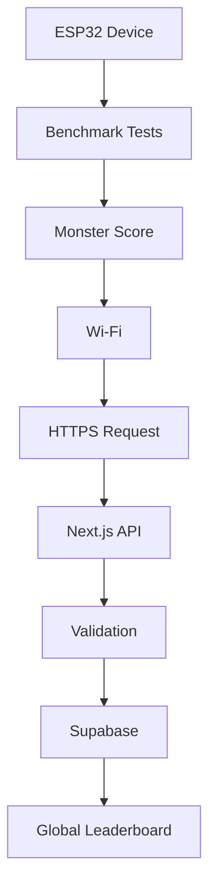
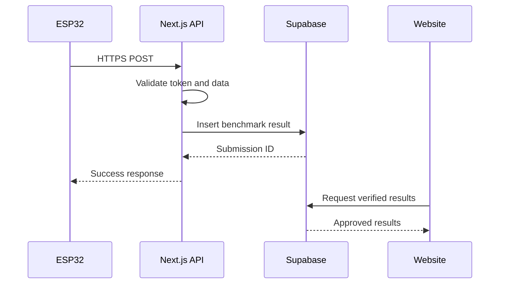

 <div align="center">

# ⚡ MONSTER ULTRA GLOBAL

### ESP32 Benchmark • Cloud Results • Global Leaderboard

<p>
  
  
  
  
  
</p>

**A global community benchmark for ESP32 devices.**

Test your ESP32. Measure its performance. Upload your results. Compare your hardware with devices around the world.

<p>
  <a href="https://esp32-benchmarksite.onrender.com/">🌐 LIVE WEBSITE</a> •
  <a href="https://github.com/HeyDander/esp32-benchmark">💻 SOURCE CODE</a>
</p>

</div>

---

## 🌍 Overview

MONSTER ULTRA GLOBAL is an experimental benchmarking project built for ESP32 microcontrollers.

The project runs performance tests directly on an ESP32, calculates a combined benchmark score called **Monster Score**, and submits results to a cloud server.

The goal is to create a global leaderboard where users can compare the performance of different ESP32 devices.

## 🌐 Live Website

<div align="center">

### [MONSTER ULTRA GLOBAL — OPEN WEBSITE](https://esp32-benchmarksite.onrender.com/)

**Global ESP32 Performance Database**

</div>

The website provides a public leaderboard for benchmark submissions.

## ✨ Features

| Feature | Description |
|---|---|
| 🧮 CPU Integer | Integer arithmetic performance |
| 🔢 CPU Float | Floating-point calculations |
| 📐 CPU Math | Mathematical workload |
| 🧠 RAM Read / Write | Memory access performance |
| 📦 RAM Copy | Memory copying performance |
| ⚡ Dual-Core | Multicore workload |
| 🔄 FreeRTOS | Task scheduling workload |
| ⏱️ Stability Test | Repeated benchmark workload |
| 📊 Monster Score | Combined experimental score |
| 📡 Wi-Fi Upload | Cloud result submission |
| 🌍 Global Leaderboard | Online result comparison |

## 🏗️ Architecture



### Technology Stack

| Technology | Purpose |
|---|---|
| ESP32 | Hardware benchmark |
| C++ | Firmware |
| Arduino IDE | Firmware development |
| Wi-Fi | Network communication |
| HTTPS | Secure transmission |
| Next.js | Website and API |
| Render | Cloud hosting |
| Supabase | Database |
| GitHub | Source code |

## 📁 Repository Structure

```text
esp32-benchmark/
│
├── firmware/
│   └── monster_ultra_global/
│       ├── monster_ultra_global.ino
│       └── config.example.h
│
├── docs/
│   └── API.md
│
├── .gitignore
├── LICENSE
└── README.md
```

## 🧰 Hardware Requirements

- ESP32 development board.
- USB data cable.
- Computer with Arduino IDE.
- Wi-Fi connection for online submissions.

The project is primarily developed for the **ESP32-WROOM-32**.

## 💻 Software Requirements

- Arduino IDE.
- Espressif ESP32 Arduino Core.
- USB serial drivers, if required.
- Internet connection for cloud uploads.

## 🚀 Installation

### 1. Clone the repository

```bash
git clone https://github.com/HeyDander/esp32-benchmark.git
cd esp32-benchmark
```

### 2. Open the firmware

Open this file in Arduino IDE:

```text
firmware/monster_ultra_global/monster_ultra_global.ino
```

### 3. Install ESP32 support

1. Open Arduino IDE.
2. Open Boards Manager.
3. Search for `esp32`.
4. Install ESP32 by Espressif Systems.
5. Select your ESP32 board.

### 4. Configure the firmware

Navigate to:

```text
firmware/monster_ultra_global/
```

Copy:

```text
config.example.h
```

Rename the copy to:

```text
config.h
```

Enter your own Wi-Fi and API configuration.

Example:

```cpp
#define WIFI_SSID       "YOUR_WIFI_NAME"
#define WIFI_PASSWORD   "YOUR_WIFI_PASSWORD"

#define SERVER_URL      "https://esp32-benchmarksite.onrender.com/api/benchmark"

#define UPLOAD_TOKEN    "YOUR_UPLOAD_TOKEN"
```

Use the exact configuration variable names from `config.example.h` if they differ.

### 5. Upload

1. Connect your ESP32.
2. Select the correct board.
3. Select the COM port.
4. Compile the sketch.
5. Upload the firmware.
6. Open Serial Monitor.

## 📡 Benchmark Tests

### CPU Integer

Measures integer arithmetic performance.

### CPU Float

Measures floating-point calculation performance.

### CPU Math

Runs mathematical calculations.

### RAM Read / Write

Measures memory access workloads.

### RAM Copy

Measures memory copying performance.

### Dual-Core Workload

Uses both ESP32 CPU cores.

### Stability Test

Repeats benchmark operations to observe performance over time.

### Heap Tracking

Tracks available heap memory during testing.

## 📊 Monster Score

The benchmark calculates a combined score called:

<div align="center">

# MONSTER SCORE

</div>

The score combines multiple benchmark measurements into one experimental performance indicator.

For meaningful comparisons:

- Use the same benchmark version.
- Use comparable hardware settings.
- Avoid changing CPU frequency between runs.
- Keep power supply conditions consistent.
- Compare individual test results as well as the combined score.

> [!IMPORTANT]
> Monster Score is an experimental metric, not an official industry standard. Do not directly compare it with scores from unrelated benchmark projects.

## ☁️ Cloud System

The cloud platform uses:

- **Render** — hosting.
- **Next.js** — backend API.
- **Supabase** — benchmark database.

### API Endpoint

```text
https://esp32-benchmarksite.onrender.com/api/benchmark
```

The ESP32 sends benchmark results to this endpoint using an HTTPS request.

### Upload Process



### Result Verification

New submissions may be stored as unverified.

Example:

```json
{
  "verified": false
}
```

Only results that pass the project's verification process should appear on the public leaderboard.

## 🔐 Security

- Never upload `config.h` to GitHub.
- Never publish Wi-Fi passwords.
- Never publish API tokens.
- Never put Supabase secret keys in firmware.
- Keep server secrets in Render environment variables.
- Use HTTPS.
- Keep TLS certificate verification enabled.
- Rotate credentials if they become exposed.

> [!CAUTION]
> A token stored inside firmware can potentially be extracted from a device. Use a dedicated upload token and do not treat it as permanently secret.

### Private Files

```text
config.h
.env
.env.local
```

Check before committing:

```bash
git status
```

Deleting a secret from the latest commit does not guarantee that it has disappeared from Git history. Rotate any exposed credentials.

## 🛠️ Troubleshooting

<details>
<summary><strong>ESP32 is not detected</strong></summary>

- Check the USB cable.
- Try another USB port.
- Check serial drivers.
- Reconnect the board.
- Select the correct COM port.

</details>

<details>
<summary><strong>Compilation error</strong></summary>

- Confirm that `config.h` exists.
- Check the sketch folder name.
- Check the installed ESP32 core.
- Read the first compiler error.

</details>

<details>
<summary><strong>Wi-Fi connection failed</strong></summary>

- Check the Wi-Fi name.
- Check the password.
- Make sure the network is available.
- Check network compatibility.

</details>

<details>
<summary><strong>Cloud upload failed</strong></summary>

- Check the API URL.
- Confirm that Render is running.
- Check server environment variables.
- Verify the upload token.
- Check HTTPS certificate validation.
- Inspect server logs.

</details>

<details>
<summary><strong>Result is uploaded but not visible</strong></summary>

The result may still be unverified. Check the database record and leaderboard verification rules.

</details>

## 🧪 Development Status

| Component | Status |
|---|---|
| ESP32 firmware | Experimental |
| CPU benchmarks | Implemented |
| RAM benchmarks | Implemented |
| Multicore workload | Implemented |
| Monster Score | Experimental |
| Wi-Fi communication | Implemented |
| Cloud API | Implemented |
| Supabase storage | Implemented |
| Website | Deployed |
| Leaderboard | Online |
| Automated verification | Under development |

## 🗺️ Roadmap

- [ ] Support more ESP32 variants.
- [ ] Add more benchmark workloads.
- [ ] Improve score calibration.
- [ ] Add historical performance charts.
- [ ] Improve result validation.
- [ ] Add duplicate submission detection.
- [ ] Add more hardware information.
- [ ] Improve leaderboard statistics.

## 🤝 Contributing

Contributions are welcome!

You can help by:

- Reporting bugs.
- Testing different ESP32 boards.
- Improving benchmark workloads.
- Improving documentation.
- Suggesting new features.
- Submitting pull requests.

### How to Contribute

1. Fork the repository.
2. Create a new branch.
3. Make your changes.
4. Test your changes.
5. Submit a pull request.

Remove passwords and tokens before sharing logs or code.

## 📄 License

This project is distributed under the license included in the repository.

See [`LICENSE`](LICENSE) for details.

---

<div align="center">

# ⚡ MONSTER ULTRA GLOBAL

### MEASURE. COMPARE. IMPROVE.

**Built for the ESP32 community.**

<a href="https://esp32-benchmarksite.onrender.com/">VISIT THE LIVE WEBSITE</a>

<sub>Independent experimental benchmark project.</sub>

</div>
