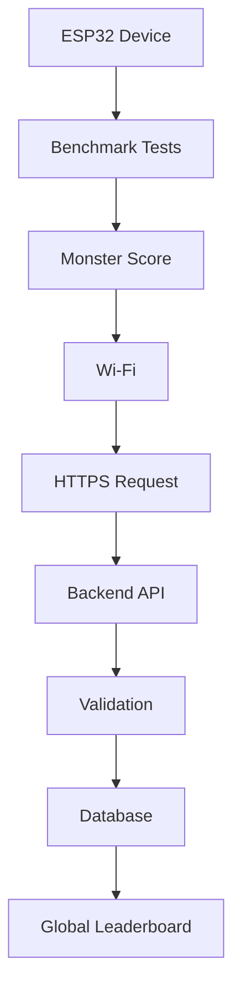
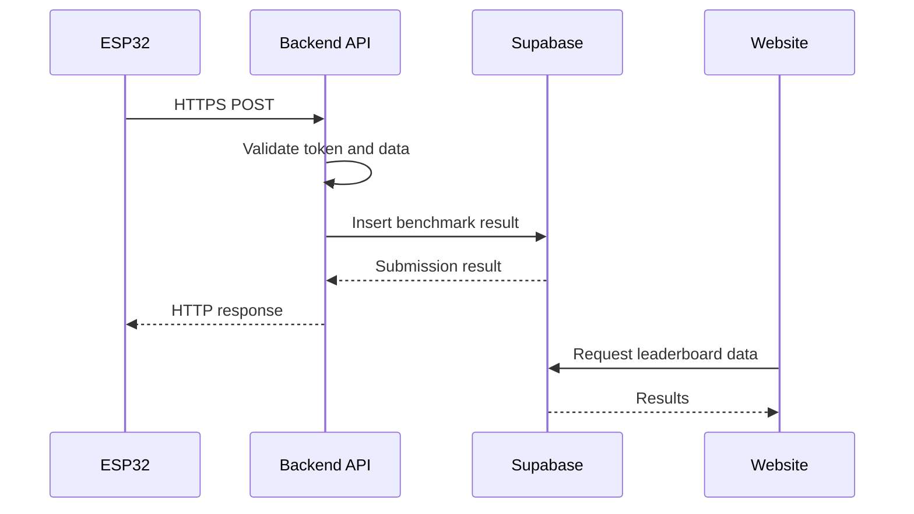

<div align="center">

# ⚡ MONSTER ULTRA GLOBAL

### ESP32 Benchmark • Cloud Results • Global Leaderboard


**A global community benchmark for ESP32 devices.**

Test your ESP32. Measure its performance. Upload your results. Compare your hardware with devices around the world.

🌐 [LIVE WEBSITE](https://esp32-benchmarksite.onrender.com/) • 💻 [SOURCE CODE](https://github.com/HeyDander/esp32_benchmark)

</div>

---

## 🌍 Overview

MONSTER ULTRA GLOBAL is an experimental benchmarking project built for ESP32 microcontrollers.

The firmware runs performance tests directly on an ESP32, calculates a combined benchmark score called **Monster Score**, and can submit the results to a cloud server over HTTPS.

The goal is to create a global leaderboard where users can compare the performance of different ESP32 devices.

## 🌐 Live Website

### [MONSTER ULTRA GLOBAL — OPEN WEBSITE](https://esp32-benchmarksite.onrender.com/)

**Global ESP32 Performance Database**

The website provides a public leaderboard for benchmark submissions.

## ✨ Features

| Feature | Description |
|---|---|
| 🧮 CPU Integer | Integer arithmetic performance |
| 🔢 CPU Float | Floating-point calculations |
| 📐 CPU Math | Mathematical workload |
| 🧠 RAM Read / Write | Memory access performance |
| 📦 RAM Copy | Memory copying performance |
| ⚡ Dual-Core | Multicore workload |
| 🔄 FreeRTOS | Task scheduling workload |
| ⏱️ Stability Test | Repeated benchmark workload |
| 📊 Monster Score | Combined experimental score |
| 📡 Wi-Fi Upload | Cloud result submission |
| 🌍 Global Leaderboard | Online result comparison |

## 🏗️ Architecture



### Technology Stack

| Technology | Purpose |
|---|---|
| ESP32 | Hardware benchmark |
| C++ | Firmware |
| Arduino IDE | Firmware development |
| Wi-Fi | Network communication |
| HTTPS | Secure transmission |
| Next.js | Website and API |
| Render | Cloud hosting |
| Supabase | Database |
| GitHub | Source code |

## 📁 Repository Structure

```text
esp32_benchmark/
│
├── firmware/
│   └── monster_ultra_global/
│       └── monster_ultra_global.ino
│
├── docs/
│   └── API.md
│
├── .gitignore
├── LICENSE
└── README.md
```

The current firmware configuration is located directly inside `monster_ultra_global.ino`.

You do not need to create a separate `config.h` or `config.example.h` for this version.

## 🧰 Hardware Requirements

- ESP32 development board.
- USB data cable.
- Computer with Arduino IDE.
- Stable power supply.
- Wi-Fi connection for online submissions.

The project is primarily developed for the **ESP32-WROOM-32**.

Other ESP32 variants may work, but their benchmark results may not be directly comparable.

## 💻 Software Requirements

- Arduino IDE.
- Espressif ESP32 Arduino Core.
- Compatible Arduino-ESP32 Core 2.x or 3.x.
- USB serial drivers, if required.
- Internet connection for cloud uploads.

## 🚀 Installation

### 1. Clone the repository

```bash
git clone https://github.com/HeyDander/esp32_benchmark.git
cd esp32_benchmark
```

### 2. Open the firmware

Open this file in Arduino IDE:

```text
firmware/monster_ultra_global/monster_ultra_global.ino
```

### 3. Install ESP32 support

1. Open Arduino IDE.
2. Open Boards Manager.
3. Search for `esp32`.
4. Install ESP32 by Espressif Systems.
5. Select your ESP32 board.
6. Select the correct USB port.

### 4. Configure the firmware

Open `monster_ultra_global.ino`.

Find the configuration section near the beginning of the file.

Enter your own Wi-Fi credentials and upload token:

```cpp
#define WIFI_SSID       "YOUR_WIFI_NAME"
#define WIFI_PASSWORD   "YOUR_WIFI_PASSWORD"

#define SERVER_URL      "https://esp32-benchmarksite.onrender.com/api/benchmark"

#define UPLOAD_TOKEN    "9b12763b31c8d9254170254bcd47f15441e7b88b4788b5069a40cc1c670d691a"
#define BOARD_MODEL     "your_esp32_model"
```

Configuration options:

| Variable | Description |
|---|---|
| `WIFI_SSID` | Your Wi-Fi network name |
| `WIFI_PASSWORD` | Your Wi-Fi password |
| `SERVER_URL` | Benchmark API address |
| `UPLOAD_TOKEN` | API upload token |
| `BOARD_MODEL` | Board model label |

**Important:** Never publish your real Wi-Fi password or upload token on GitHub.

### 5. Upload the firmware

1. Connect your ESP32 to your computer.
2. Select the correct board.
3. Select the correct USB port.
4. Compile the sketch.
5. Upload the firmware.
6. Open Serial Monitor.
7. Set the baud rate to `115200`.
8. Reset the ESP32 if necessary.

The benchmark will start and print its progress and results to Serial Monitor.

## 📡 Benchmark Tests

### CPU Integer

Measures integer arithmetic performance.

### CPU Float

Measures floating-point calculation performance.

### CPU Math

Runs mathematical calculations.

### RAM Read / Write

Measures memory access workloads using the firmware's test buffers.

### RAM Copy

Measures memory copying performance.

### Dual-Core Workload

Uses both ESP32 CPU cores for a multicore workload.

### FreeRTOS Workload

Measures a task scheduling / yield workload.

### Stability Test

Repeats benchmark operations to observe performance over a short period.

### Heap Tracking

Tracks available heap memory during testing.

## 📊 Monster Score

The benchmark calculates a combined score called:

# MONSTER SCORE

The score combines multiple benchmark measurements into one experimental performance indicator.

For meaningful comparisons:

- Use the same benchmark version.
- Use comparable hardware settings.
- Avoid changing CPU frequency between runs.
- Keep power supply conditions consistent.
- Compare individual test results as well as the combined score.

> [!IMPORTANT]
> Monster Score is an experimental metric, not an official industry standard. Scores from different benchmark versions may not be directly comparable.

## ☁️ Cloud System

The cloud platform uses:

- **Render** — hosting.
- **Next.js** — backend API.
- **Supabase** — database.

### API Endpoint

```text
https://esp32-benchmarksite.onrender.com/api/benchmark
```

The ESP32 sends benchmark results to this endpoint using an HTTPS POST request.

### Upload Process



### HTTPS Connection

The simplified firmware uses:

```cpp
WiFiClientSecure client;
client.setInsecure();
```

This allows the ESP32 to establish an HTTPS connection without manually configuring a root CA certificate.

**Security note:** `setInsecure()` disables server certificate verification. The connection is encrypted, but the ESP32 does not verify that it is communicating with the genuine server. This is a development convenience, not the recommended configuration for production. For a public release, use a trusted root CA certificate with certificate verification enabled.

### Upload Timeouts

The cloud service may sometimes take longer to respond, especially after a period without requests.

Possible reasons include:

- Render service startup.
- Slow server response.
- Unstable Wi-Fi connection.
- Incorrect API configuration.
- Backend processing delays.

If an upload fails, the local benchmark can still finish. Check Serial Monitor and the Render service logs to investigate the problem.

## 🔐 Security

- Never upload `config.h` or files containing real credentials.
- Never publish Wi-Fi passwords.
- Never publish API tokens.
- Never put Supabase secret keys in firmware.
- Keep backend secrets in Render environment variables.
- Use HTTPS.
- Remember that tokens stored in firmware can potentially be extracted.
- Use a dedicated upload token.

Recommended `.gitignore` entries:

```gitignore
.DS_Store
config.h
.env
.env.local
```

Before committing changes, check:

```bash
git status
```

Deleting a secret from the latest commit does not guarantee that it has disappeared from Git history. Rotate credentials if they have been exposed.

## 🛠️ Troubleshooting

<details>
<summary><strong>ESP32 is not detected</strong></summary>

- Check the USB cable.
- Try another USB port.
- Check serial drivers.
- Reconnect the board.
- Select the correct port.

</details>

<details>
<summary><strong>Compilation error</strong></summary>

- Check that the correct `.ino` file is open.
- Confirm that ESP32 board support is installed.
- Select the correct board.
- Check the first compiler error.
- Verify Arduino-ESP32 core compatibility.

</details>

<details>
<summary><strong>Wi-Fi connection failed</strong></summary>

- Check `WIFI_SSID`.
- Check `WIFI_PASSWORD`.
- Make sure the network is available.
- Check signal strength.
- Make sure the ESP32 has stable power.

</details>

<details>
<summary><strong>HTTP code: -11 / read Timeout</strong></summary>

This means the ESP32 timed out while waiting for a response.

Possible causes:

- The Render service is starting up.
- The backend is responding too slowly.
- The Wi-Fi connection is unstable.
- The server is not reachable.
- The API handler is taking too long.

To investigate:

1. Check the Wi-Fi connection.
2. Verify `SERVER_URL`.
3. Check Render service logs.
4. Look for the POST request in the logs.
5. Check whether the backend returned a response.
6. Retry after the service has started.

</details>

<details>
<summary><strong>Brownout detector was triggered</strong></summary>

A brownout warning usually indicates that the ESP32 supply voltage dropped below a safe level.

Try:

- Using a different USB data cable.
- Using a stable USB power source.
- Disconnecting unnecessary peripherals.
- Checking the power supply.

Do not disable the brownout detector to hide a power problem.

</details>

<details>
<summary><strong>Result is uploaded but not visible</strong></summary>

The result may still be unverified or waiting for the backend's verification process.

Check the database record and leaderboard verification rules.

</details>

## 🧪 Development Status

| Component | Status |
|---|---|
| ESP32 Firmware | Experimental |
| CPU Benchmarks | Implemented |
| RAM Benchmarks | Implemented |
| Multicore Workload | Implemented |
| FreeRTOS Workload | Implemented |
| Monster Score | Experimental |
| Wi-Fi Communication | Implemented |
| HTTPS Upload | Implemented |
| Cloud API | Deployed |
| Website | Online |
| Leaderboard | Online |
| Automated Verification | Under Development |

## 🗺️ Roadmap

- [ ] Support more ESP32 variants.
- [ ] Add more benchmark workloads.
- [ ] Improve score calibration.
- [ ] Add historical performance charts.
- [ ] Improve result validation.
- [ ] Add duplicate submission detection.
- [ ] Add more hardware information.
- [ ] Improve leaderboard statistics.

## 🤝 Contributing

Contributions are welcome!

You can help by:

- Reporting bugs.
- Testing different ESP32 boards.
- Improving benchmark workloads.
- Improving documentation.
- Suggesting new features.
- Submitting pull requests.

### How to Contribute

1. Fork the repository.
2. Create a new branch.
3. Make your changes.
4. Test your changes.
5. Submit a pull request.

Remove passwords and tokens before sharing logs or code.

## 📄 License

This project is distributed under the license included in the repository.

See [`LICENSE`](LICENSE) for details.

---

<div align="center">

# ⚡ MONSTER ULTRA GLOBAL

### MEASURE. COMPARE. IMPROVE.

**Built for the ESP32 community.**

[VISIT THE LIVE WEBSITE](https://esp32-benchmarksite.onrender.com/)

<sub>Independent experimental benchmark project.</sub>

</div>

