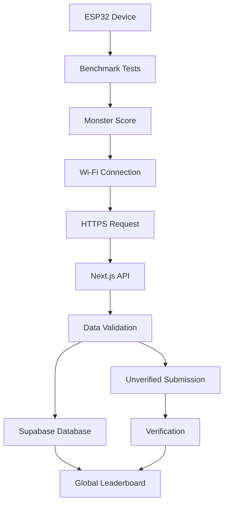
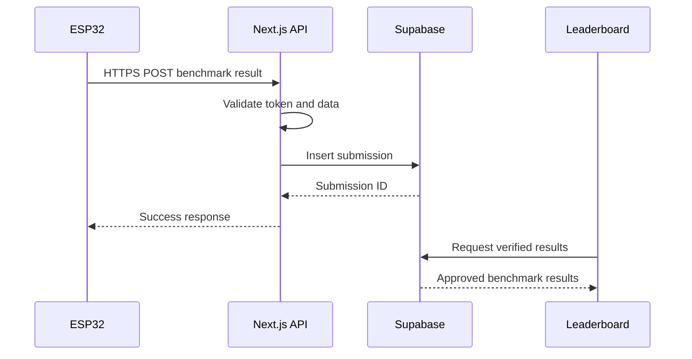

&#x20;\<div align="center">

# ⚡ MONSTER ULTRA GLOBAL

### ESP32 Benchmark • Cloud Results • Global Leaderboard

\<p>   \   \   \   \   \ \</p>

**A global community benchmark for ESP32 devices.**

Test your ESP32. Measure its performance. Upload your results. Compare your hardware with other devices around the world.

\<p>
&#x20; \<a href="#-overview">Overview\</a> •
&#x20; \<a href="#-features">Features\</a> •
&#x20; \<a href="#-installation">Installation\</a> •
&#x20; \<a href="#-cloud-system">Cloud System\</a> •
&#x20; \<a href="#-security">Security\</a> •
&#x20; \<a href="#-contributing">Contributing\</a>
\</p>

\</div>

---

## 🌍 Overview

**MONSTER ULTRA GLOBAL** is an experimental benchmarking project built for ESP32 microcontrollers.

The project runs multiple performance tests directly on an ESP32, calculates a combined benchmark score called **Monster Score**, and can submit the results to a cloud server.

The long-term goal is to create a global leaderboard where users can compare the performance of different ESP32 boards.

> [!IMPORTANT]
> MONSTER ULTRA GLOBAL is an independent experimental project. It is not an official Espressif benchmark. Scores should primarily be compared between devices tested with the same benchmark version and settings.

## ✨ Features

| Feature               | Description                            |
| --------------------- | -------------------------------------- |
| 🧮 CPU Integer        | Integer arithmetic performance         |
| 🔢 CPU Float          | Floating-point calculations            |
| 📐 CPU Math           | Mathematical workload                  |
| 🧠 RAM Read / Write   | Memory access performance              |
| 📦 RAM Copy           | Memory copying performance             |
| ⚡ Dual-Core           | Multicore workload                     |
| 🔄 FreeRTOS           | Task scheduling and yield workload     |
| ⏱️ Stability Test     | Repeated benchmark workload            |
| 📊 Monster Score      | Combined experimental benchmark score  |
| 📡 Wi-Fi Upload       | Sends results to the cloud             |
| 🌍 Global Leaderboard | Online comparison of submitted results |

## 🏗️ Architecture

The project consists of two main parts:

1. ESP32 firmware — performs the benchmark.
2. Cloud platform — receives, stores, and displays benchmark results.

### System diagram



### Technology stack

| Technology  | Purpose                  |
| ----------- | ------------------------ |
| ESP32       | Hardware benchmark       |
| C++         | Firmware                 |
| Arduino IDE | Firmware development     |
| Wi-Fi       | Network communication    |
| HTTPS       | Secure data transmission |
| Next.js     | Website and API          |
| Render      | Cloud hosting            |
| Supabase    | Database                 |
| GitHub      | Source code hosting      |

## 📁 Repository Structure

```text
esp32-benchmark/
│
├── firmware/
│   └── monster_ultra_global/
│       ├── monster_ultra_global.ino
│       └── config.example.h
│
├── docs/
│   └── API.md
│
├── .gitignore
├── LICENSE
└── README.md
```

| File                       | Description                   |
| -------------------------- | ----------------------------- |
| `monster_ultra_global.ino` | Main ESP32 benchmark firmware |
| `config.example.h`         | Example configuration         |
| `docs/API.md`              | API documentation             |
| `.gitignore`               | Files excluded from Git       |
| `LICENSE`                  | Project license               |
| `README.md`                | Project documentation         |

## 🧰 Hardware Requirements

- ESP32 development board.
- USB data cable.
- Computer with Arduino IDE.
- Wi-Fi connection for online submissions.

The project is primarily developed for the **ESP32-WROOM-32**.

Other ESP32 variants may require compatibility adjustments.

## 💻 Software Requirements

- Arduino IDE.
- Espressif ESP32 Arduino Core.
- USB serial drivers, if required by your board.
- Internet connection for cloud uploads.

## 🚀 Installation

### 1. Clone the repository

```bash
git clone https://github.com/HeyDander/esp32-benchmark.git
```

Open the repository folder:

```bash
cd esp32-benchmark
```

### 2. Open the firmware

Open:

```text
firmware/monster_ultra_global/monster_ultra_global.ino
```

Use Arduino IDE to open the sketch.

### 3. Install ESP32 support

In Arduino IDE:

1. Open Boards Manager.
2. Search for `esp32`.
3. Install the ESP32 package by Espressif Systems.
4. Select your ESP32 board.

### 4. Configure the firmware

Navigate to:

```text
firmware/monster_ultra_global/
```

Copy:

```text
config.example.h
```

Rename the copy to:

```text
config.h
```

Open `config.h` and enter your local configuration.

Example:

```cpp
// Example configuration only.
// Use the exact variable names from config.example.h.

#define WIFI_SSID       "YOUR_WIFI_NAME"
#define WIFI_PASSWORD   "YOUR_WIFI_PASSWORD"

#define SERVER_URL      "https://YOUR-RENDER-SERVICE.onrender.com/api/benchmark"

#define UPLOAD_TOKEN    "YOUR_UPLOAD_TOKEN"
```

> [!WARNING]
> The example values above are placeholders. Follow the actual definitions in `config.example.h` if their names differ.

### 5. Select your board

In Arduino IDE:

- Select your ESP32 board.
- Select the correct COM port.
- Check the board settings.
- Compile the sketch.

### 6. Upload the firmware

Connect your ESP32 through USB and upload the firmware.

Open Serial Monitor using the baud rate configured in the sketch.

You should see benchmark progress and results.

## 📡 Benchmark Tests

MONSTER ULTRA GLOBAL performs several workloads to measure different aspects of ESP32 performance.

### CPU Integer

Measures integer arithmetic performance.

### CPU Float

Measures floating-point calculation performance.

### CPU Math

Runs additional mathematical calculations.

### RAM Read / Write

Measures memory access workloads.

### RAM Copy

Measures memory copying performance.

### Dual-Core Workload

Uses both ESP32 CPU cores to evaluate multicore performance.

### Stability Test

Repeats benchmark operations to observe performance during a longer workload.

### Heap Tracking

Tracks available heap memory during testing.

## 📊 Monster Score

The benchmark calculates a combined score called:

# MONSTER SCORE

The score is designed to make benchmark results easier to compare.

It combines multiple test results into one experimental performance indicator.

**Important considerations:**

- Different ESP32 models may have different capabilities.
- Chip revisions can affect performance.
- CPU frequency affects results.
- Temperature and power supply can affect measurements.
- Different firmware versions may use different scoring formulas.

For meaningful comparisons, use the same benchmark version and comparable hardware settings.

## ☁️ Cloud System

MONSTER ULTRA GLOBAL supports online benchmark submissions.

The cloud architecture uses:

- Render for hosting.
- Next.js for the backend API.
- Supabase for storing benchmark results.

### API endpoint

The firmware must send results to your deployed API:

```text
https://YOUR-RENDER-SERVICE.onrender.com/api/benchmark
```

Replace `YOUR-RENDER-SERVICE` with your actual Render hostname.

Do not use `localhost` in the ESP32 configuration. The ESP32 cannot use your computer's localhost address to reach a cloud service.

### Upload process



### Submission verification

A successful API upload does not automatically mean that a result is verified.

New submissions may be stored with:

```json
{
  "verified": false
}
```

Only results that pass the project's verification process should appear on the public leaderboard.

See [`docs/API.md`](docs/API.md) for API details.

## 🔐 Security

Security is important because the firmware communicates with an online service.

Follow these rules:

- Never upload `config.h` to GitHub.
- Never publish Wi-Fi passwords.
- Never publish API tokens.
- Never put Supabase secret keys inside ESP32 firmware.
- Keep server-side secrets in Render environment variables.
- Use HTTPS for cloud communication.
- Keep TLS certificate verification enabled.
- Rotate credentials if they become public.

> [!CAUTION]
> A token stored inside firmware can potentially be extracted from the device. Treat the upload token as a credential that may be exposed, and use a dedicated token with limited permissions.

### Files that should remain private

```text
config.h
.env
.env.local
```

Check your Git status before committing:

```bash
git status
```

Deleting a secret from the latest version of a repository does not guarantee that it has disappeared from Git history. Rotate any exposed credentials.

## 🛠️ Troubleshooting

\<details>
\<summary>\<strong>ESP32 board is not detected\</strong>\</summary>

- Check your USB cable.
- Try another USB port.
- Check the serial drivers.
- Reconnect the board.
- Check the selected COM port.

\</details>

\<details>
\<summary>\<strong>Compilation error\</strong>\</summary>

- Confirm that `config.h` exists.
- Check that the sketch folder and `.ino` filename match.
- Confirm that the ESP32 board package is installed.
- Check the first compiler error.
- Verify that the installed core is compatible with the firmware.

\</details>

\<details>
\<summary>\<strong>Wi-Fi connection failed\</strong>\</summary>

- Check the Wi-Fi name.
- Check the password.
- Make sure the network is available.
- Check whether your ESP32 supports the network's Wi-Fi band.

\</details>

\<details>
\<summary>\<strong>Cloud upload failed\</strong>\</summary>

- Check the API URL.
- Confirm that the Render service is running.
- Check the server environment variables.
- Verify that the device and server upload tokens match.
- Check HTTPS certificate validation.
- Inspect the server logs.

\</details>

\<details>
\<summary>\<strong>Result uploaded but not visible on leaderboard\</strong>\</summary>

The submission may have been accepted but remain unverified.

Check the database record and the leaderboard's verification rules.

\</details>

## 🧪 Development Status

MONSTER ULTRA GLOBAL is an actively developing experimental project.

| Component                | Status            |
| ------------------------ | ----------------- |
| ESP32 benchmark firmware | Experimental      |
| CPU tests                | Implemented       |
| RAM tests                | Implemented       |
| Multicore workload       | Implemented       |
| Monster Score            | Experimental      |
| Wi-Fi communication      | Implemented       |
| Cloud API                | Implemented       |
| Supabase storage         | Implemented       |
| Public leaderboard       | Under development |
| Automated verification   | Under development |

Features and compatibility may change between releases.

## 🗺️ Roadmap

Planned development directions:

- [ ] Support for more ESP32 variants.
- [ ] More benchmark workloads.
- [ ] Improved score calibration.
- [ ] Benchmark version tracking.
- [ ] Historical performance charts.
- [ ] Better result validation.
- [ ] Duplicate submission detection.
- [ ] More detailed hardware information.
- [ ] Improved leaderboard statistics.

## 🤝 Contributing

Contributions are welcome!

You can help by:

- Reporting bugs.
- Testing different ESP32 boards.
- Improving benchmark workloads.
- Improving documentation.
- Suggesting new features.
- Submitting pull requests.

### How to contribute

1. Fork the repository.
2. Create a new branch.
3. Make your changes.
4. Test your changes.
5. Create a pull request.

Please remove passwords, tokens, and other private information before submitting logs or code.

## 📄 License

This project is distributed under the license included in the repository.

See [`LICENSE`](LICENSE) for details.

---

\<div align="center">

# ⚡ MONSTER ULTRA GLOBAL

### Measure. Compare. Improve.

**Built for the ESP32 community.**

\<sub>Independent experimental benchmark project.\</sub>

\</div>
